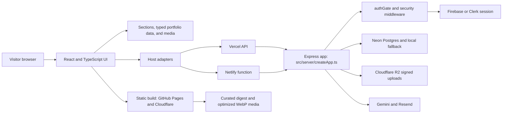

# The Kalyan Chronicle

An interactive engineering broadsheet for Saragadam Kalyan: project profiles, architecture and tools, a GitHub/Substack digest, grounded RAG, package analysis, and a developer workbench.

## Stack

- React 19, TypeScript, Vite, Tailwind CSS, Motion, and a PWA service worker
- Express API with Helmet security headers, request limits, input validation, and protected mutations
- Clerk sessions when Clerk keys are configured; Firebase Google sign-in is the ready-to-run fallback
- Neon Postgres and Cloudflare R2 are optional server-side services; local mode falls back to Firestore/local storage where implemented
- Gemini and Resend are optional server-side integrations

## Architecture



- `src/components` renders the newspaper sections; `src/data` owns the typed project and fallback-digest content; `src/utils` contains safe URL, print, and public-asset helpers.
- `src/server/createApp.ts` owns API routes. `api/index.ts` adapts it for Vercel, `netlify/functions/api.ts` adapts it for Netlify, and `server.ts` runs it locally.
- Static builds use a base-aware media resolver and a bundled archive. They do not poll API routes that static hosts cannot serve. The GitHub Pages build uses `/the-kalyan-chronicle/` as its base path.
- Protected writes verify Firebase or Clerk identity on the server. Optional Neon and R2 integrations stay behind that boundary; static portfolios and demos do not gain artificial service dependencies.

### Invariants and side effects

- Browser bundles contain no server credentials; auth tokens are verified before protected writes.
- Public media paths are resolved from Vite's configured base path; the lead image loads eagerly, while below-the-fold plates load lazily.
- API routes may write to Neon, R2, Firebase, or Resend only when those integrations are configured.
- `bun run lint`, `bun run test`, `bun run build`, `bun audit --production --audit-level=high`, and `bunx tsx scripts/verify-all-services.ts` cover the source and service contracts.

## Run locally

Requirements: Node.js 22 or later and Bun 1.4 or later.

```sh
bun install --frozen-lockfile
Copy-Item .env.example .env
bun run dev
```

The UI can be explored without paid AI services. Configure only the services you use. Never put server secrets in a `VITE_` variable. The Firebase browser config contains a public API key; protect its data with Firebase Security Rules and restrict the key in Google Cloud.

## Authentication and security

The frontend presents Clerk sign-in when both `VITE_CLERK_PUBLISHABLE_KEY` and server-side `CLERK_SECRET_KEY` are set. The backend verifies Clerk sessions before reader mutations. Without those keys, the Firebase sign-in UI is used; server routes verify Firebase ID token signature, issuer, audience, expiry, and verified-email status. Firestore access is denied by default and scoped to the authenticated owner in `firestore.rules`.

Mutating API routes enforce same-origin checks, schema validation, request-size limits, rate limits, and server-only credentials. R2 upload grants are short-lived and restrict content types and size. Neon, R2, Gemini, Resend, Clerk, and cron secrets belong in each host's secret/environment-variable manager; do not commit `.env` files.

## Verify

```sh
bun run lint
bun test
bun run build
```

## Hosting

| Host | Deployment shape | Notes |
| --- | --- | --- |
| Vercel | Full app: Vite frontend and Express API via `api/index.ts` | Set server secrets in project settings. |
| Netlify | Vite frontend and Express API through `netlify/functions/api.ts` | `netlify.toml` maps `/api/*` to the function. |
| Cloudflare Pages | Static frontend with Pages middleware and R2 configuration | Pages Functions do not run the Express server in this repository; server-only API features need a compatible API origin. |
| Deno Deploy | Dynamic Express server (`server.ts`) or static frontend | Requires a Deno Deploy account/token and app selection. Deno has announced the service sunset for April 2027. |
| GitHub Pages | Static Vite/PWA frontend | The workflow publishes the static experience at `/the-kalyan-chronicle/`; server API features need an external API deployment. |

GitHub Actions deploy workflows require provider secrets before they can publish. Deployment success is verified by the provider URL and runtime response; a successful build alone is not a live deployment.

## Environment variables

See `.env.example` for the full set. Minimum server-side auth options are either both Clerk keys or the Firebase project configuration already present in `firebase-applet-config.json`. Add `GEMINI_API_KEY`, `DATABASE_URL`, R2 credentials, and email/cron credentials only when enabling those services.
